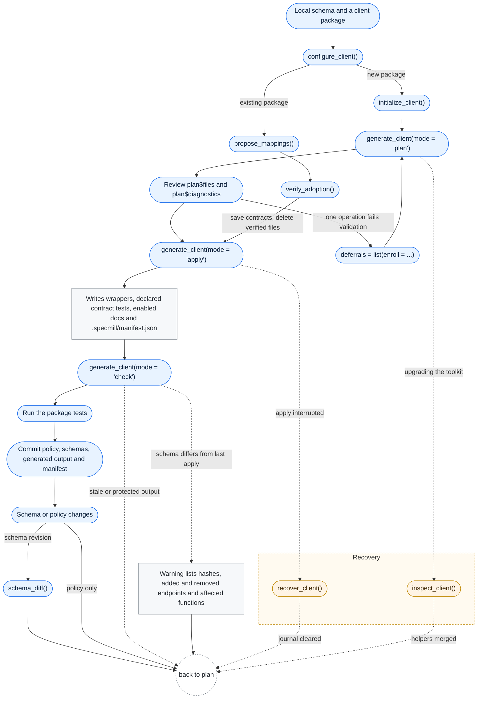

# specmill 

Generate and maintain R API clients from local OpenAPI schemas and reviewed YAML
policy. specmill creates wrappers, documentation, and request contract tests while
your package keeps control of HTTP, authentication, and response handling.
Your package's users do not need specmill installed.

## Install

These guides describe the current package. Install the latest published release
from GitHub, or pin a reviewed release tag or commit for reproducible generation.

```r
install.packages('remotes')
remotes::install_github('seanthimons/specmill@*release')
```

For unreleased changes, install `seanthimons/specmill@main` instead.
Check `packageVersion('specmill')` after starting a fresh R session.

For an existing project with a toolkit lock, use its own installer to get the
reviewed version.

## Choose your starting point

- **New package:** [Start a new API client](https://seanthimons.github.io/specmill/articles/specmill.html)
  walks through initialization, generation, and an offline verification.
- **Existing package:** [Adopt an existing client](https://seanthimons.github.io/specmill/articles/existing-clients.html)
  explains preserving public functions, helpers, hooks, and generated-file ownership.

`initialize_client()` writes service YAML from schema
tags, including editable function names and exact operation selections.
`configure_client()` previews the configuration for a new or existing package.
Use `naming = 'tag_prefix'` for names such as `pet_get_by_id`, or
`naming = 'path'` for route-derived names when operation IDs are unreliable.
Review the proposed `names` map and collision diagnostics before applying.

Once a project has `specmill.yml`, the maintenance loop is:

```r
root <- '/absolute/path/to/your/client'
plan <- specmill::generate_client(root, config = 'specmill.yml', mode = 'plan')
plan$files
plan$diagnostics
# Review the plan, then apply and verify:
specmill::generate_client(root, config = 'specmill.yml', mode = 'apply')
specmill::generate_client(root, config = 'specmill.yml', mode = 'check')
```

When an upstream revision breaks one operation, `deferrals = list(enroll = ...)`
can withhold that single contract revision until its schema changes, instead of
blocking the whole client. Default behavior stays strict; see
[Maintenance and CI](https://seanthimons.github.io/specmill/articles/maintenance.html).
Deferral preserves existing output; to remove a retired operation's files, help
page, export and ownership record, opt in with `prune = '<service> METHOD /path'`
(or `prune = 'all'`, which asks for confirmation).

## Review schema and toolkit updates

When a schema changes, `plan$schema_changes` reports endpoint additions and
removals, and check mode warns when schemas differ from the last apply.
Use [maintenance](https://seanthimons.github.io/specmill/articles/maintenance.html)
for the review loop, `regeneration_report()` for a read-only clean-regeneration
and manual-code inventory, and explicit `prune` requests for reviewed removals.

A failing operation can be deferred for its current contract revision while
other operations continue. Deferral retries when that contract changes;
selection exclusions deliberately stop generating an operation instead. Follow
[Defer or skip an operation](https://seanthimons.github.io/specmill/articles/deferral.html)
for an executable example. Keep independent fixed contracts in RDS or readable
YAML/JSON; route keys such as `GET /items/{item_id}` survive wrapper renames.
See [testing](https://seanthimons.github.io/specmill/articles/testing.html).

## Adapt incomplete API schemas

Keep the upstream schema intact and record reviewed exceptions in service YAML.
For example, when an API declares its key both as authentication and as a required
query argument, map the security scheme directly to an existing environment
variable, exclude the redundant argument, and correct missing security requirements
on verified routes. Regeneration preserves that policy without hand-editing wrappers.
See [adapt inconsistent authentication metadata](https://seanthimons.github.io/specmill/articles/configuration.html#adapt-inconsistent-authentication-metadata)
for the combined recipe, compatibility checks, and query-secret limits.

## Generated client request controls

New clients include exported session controls prefixed with their package name:

```r
catalogueclient::catalogueclient_run_verbose(TRUE) # Report HTTP method and response status.
catalogueclient::catalogueclient_dry_run(TRUE)     # Return a prepared httr2 request; send nothing.
catalogueclient::catalogueclient_dry_run(FALSE)    # Resume actual requests.
catalogueclient::catalogueclient_run_verbose(FALSE)
```

Function names preserve the package name, including case and dots; generic
`run_verbose()` and `dry_run()` aliases are not exported, so attaching multiple
clients does not mask these controls. Both default to off and require one
nonmissing logical value. They set
`catalogueclient.run_verbose` and `catalogueclient.dry_run` R options; the prefix
uses the same lowercase package naming as the request options below. Multi-API
clients share these settings across their helpers. An explicit `dry_run` option
overrides the existing `CATALOGUECLIENT_DRY_RUN` environment flag, including when
FALSE. Remove the option with `options(catalogueclient.dry_run = NULL)` to restore
the environment fallback. No profile or environment files are changed.

Verbose messages omit URLs, headers, query values and bodies. Dry-run requests
still validate inputs and authentication, and the returned object may contain
credentials. These setters live in client-owned `R/api_options.R`, created during
initialization and exported when documentation is generated. Existing clients
need manual adoption of that file and the updated request helper; regeneration
does not replace client-owned helpers or add these setters to older clients.

The baseline `specmill.yml` includes:

```yaml
defaults:
  request_controls:
    timeout: 30
    max_retries: 0
    retry_writes: false
```

Edit these values and run `generate_client()` to update the generated helper
calls. `max_retries` counts retries after the initial attempt, so `2` allows
three total attempts. Defaults inherit through project, API/service/group, and
operation settings, with later settings overriding individual fields. Values
are validated when loading YAML. Timeout must be finite and positive; retries
must be a nonnegative integer; write permission must be a boolean.

New helpers also read one package-scoped R option on every call. Runtime options
override the YAML defaults per field. For a package named `catalogueclient`:

```r
options(catalogueclient.request = list(
  base_url = 'https://staging.example.org/v1',
  timeout = 30,
  max_retries = 2,
  retry_writes = FALSE
))
```

The option prefix is the lowercase dry-run prefix: punctuation in package names
becomes `_`. All helpers in a multi-API package share this option; setting
`base_url` overrides every API, so omit it unless that is intended. Omitted fields
use the generated YAML defaults, falling back to 30 seconds per attempt, zero
retries, and no permission to retry non-idempotent writes when YAML controls are
absent. Base URL overrides remain runtime options or initialization settings. Reset with
`options(catalogueclient.request = NULL)`. Invalid controls fail before HTTP.

URL precedence is runtime `base_url`, then the explicit initialization
`base_url` or reviewed multi-API catalogue URL, then operation, path, and root
schema servers. An inferred root URL is only the direct helper-call default;
generated wrappers carry their effective server. Server-variable string defaults
are substituted. One distinct absolute HTTP(S) URL is required; credentials,
query strings, fragments, invalid ports, and unresolved templates are rejected.

Ambiguous servers, missing variable defaults, unsupported schemes, and relative
URLs without an origin produce `server_diagnostics` in `read_operations()` and
generation plans. The generated helper refuses those calls unless an explicit
URL override resolves selection. These diagnostics do not block generation,
since the override is chosen at runtime. An empty server array selects the
OpenAPI default `/`, which also needs an origin or override. Catalogue discovery
can resolve relative root URLs against its recorded origin and assemble Swagger
`schemes`, `host`, and `basePath`; multiple schemes need a reviewed URL. Missing
Swagger host/scheme fields need a recorded origin or explicit override. Direct
local-schema parsing does not infer a download origin. Named server selection
and runtime variable substitutions require a client-owned helper.

When enabled, retries apply to GET, HEAD, OPTIONS, PUT, and DELETE. POST, PATCH,
and other methods require `retry_writes = TRUE`; enable it only when the API can
safely replay the request, for example with its own idempotency key. The helper
retries HTTP 408, 429, 500, 502, 503, and 504, with at most `max_retries + 1`
attempts. It uses [httr2 retry support](https://httr2.r-lib.org/reference/req_retry.html)
for Retry-After and jittered exponential backoff. Connection/TLS failures and
JSON decode errors are not retried. Timeout limits each attempt, not the total
call including Retry-After waits. Exhausted HTTP and JSON errors retain status
and media type without response bodies or credentials; connection errors use a
fixed credential-safe message.

Select a client-owned retry predicate when an API needs another status policy.
For example, put this function in the generated client's `R/retry_policy.R`:

```r
retry_server_errors <- function(response) {
  status <- httr2::resp_status(response)
  status == 429L || (status >= 500L && status < 600L)
}
```

Select its name in reviewed YAML:

```yaml
defaults:
  request_controls:
    max_retries: 2
    retry_policy: retry_server_errors
```

This retries 429 and all 5xx responses, excludes 408 and permanent 4xx, and
allows three total attempts. A narrower predicate can select individual statuses
or inspect response headers. Predicates receive one httr2 response and must
return one nonmissing logical value. YAML contains a function name, never R code;
generation verifies that the name resolves to a client function and does not
collide with a wrapper. Runtime `catalogueclient.request` options also accept a
function or its client-local name in `retry_policy`. Omission retains the native
status set; `retry_policy: null` clears an inherited YAML policy.
Policy selection does not authorize POST/PATCH replay; `retry_writes` still
controls that. Invalid names and controls fail before HTTP. Predicate errors and
invalid results produce credential-safe errors after the response arrives.

Existing `R/api_request.R` files remain client-owned and are never refreshed by
normal generation. New scaffolds retain their substituted baseline under
`.specmill/helpers/`. Use `inspect_client(root)$helpers` for read-only baseline,
local and proposed comparisons; legacy helpers without provenance stay unknown.
Adoption remains manual. See [updating an existing client](https://seanthimons.github.io/specmill/articles/existing-clients.html#update-an-already-configured-client)
for helper review and verification steps. To adopt these controls, merge the `server` and
`request_controls` arguments, YAML-default fallback, URL selection/validation,
option validation, and `req_timeout()`/`req_retry()` setup
from [`inst/templates/request.R`](https://github.com/seanthimons/specmill/blob/main/inst/templates/request.R) into your helper.
Replace its `BASE_URL` and `DRY_RUN_ENV` placeholders with your client's defaults;
set the initialization override only if you intend it to beat schema servers.
Keep your authentication and response handling. Generation checks that custom
helpers accept the `server` and configured `request_controls` arguments or `...`; accepting and ignoring it is
not an implementation of server selection. Complete request mappings retain
control of their own helper arguments. Proxy/TLS settings, streaming,
cancellation and per-API runtime controls still require
a custom helper.

## Client-owned batching and pagination

Select reusable companions when initializing a client:

```r
specmill::initialize_client(
  root, schema, package = 'catalogueclient', title = 'Catalogue Client',
  author = list(given = 'Example', family = 'Maintainer', email = 'you@example.org'),
  license = 'MIT + file LICENSE', companions = c('batching', 'pagination')
)
```

This emits `api_request_batched()`, `api_request_paginated()`, and
`api_request_paginated_links()` in the existing client-owned request helper.
Multi-API clients use their own helper prefixes. Generated clients need no
specmill runtime dependency. Pagination declares `digest`; next-link retrieval
requires httr2 1.3.0 or later. Ordinary wrappers still make one request.
Set `batch.fan_out` or `batch.split` in YAML to have a wrapper send one request
per vector element or per `max_items` chunk and combine the results, or
`pagination` to have it request every page; see `vignette('configuration')`, and
`vignette('paged-wrappers')` for how callers use a paging wrapper.

Configure shared policy once per package and helper, with call-specific exceptions:

```r
options(catalogueclient.api_request.pagination = list(
  mode = 'page', parameter = 'page', size_parameter = 'per_page',
  start = 1, page_size = 50, items = function(response) response$data
))
result <- catalogueclient::api_request_paginated(list_items, category = 'books')
```

The package option prefix is lowercase, with punctuation replaced by underscores.
Use the actual helper name in the option key. Explicit pagination arguments override
policy fields. A supplied batching `policy` replaces its shared policy. Keep
persistent service policy in client-owned R code that passes the same list to
these companions; do not set global options while loading a package.

Batching validates an explicit positive integer size before any request, preserves
input order and values, and returns unmerged chunk results. Normalization,
`build(chunk, index)` body construction, `merge(results)`, and warning-based
`on_error = 'drop'` or `'keep'` recovery are explicit policy choices. Every chunk
uses the supplied wrapper's authentication, query parameters, retries and response
policy. The oversized single-request guard remains.

Pagination accepts exact argument names or nested paths such as
`c('body', 'pagination', 'cursor')`, preserving unrelated body state. Select
`completed(response, state)`, `advance(response, position, page_size)`,
`stop_on_short`, and `next_cursor` explicitly for your API. No parameter names
or response collections are guessed. Defaults stop on empty pages, propagate
errors, and preserve unmerged pages. Emitted companions bound requests with
`max_pages = 100`, warn on truncation, and have no item cap unless `max_items`
is explicitly supplied. Toolkit `specmill::paginated()` retains its original
10,000-item cap and silent-limit defaults.

Keep response envelopes and metadata intact in the #63 response policy during
fetches. A selected `format(result)` runs once after iteration finishes. A
single-request `post_response` hook that removes totals or tokens must be omitted
or adapted for paginated fetching. No decoder is duplicated. Explicit
`error_policy = 'partial'` or `'empty'` warns and retains or discards successful
pages; extraction and security failures still propagate.

Composing batching around pagination visits every chunk by default. The batching
policy `first_batch_only = TRUE` explicitly preserves ComptoxR's historical
first-batch-only pagination. It is a compatibility choice, never a default.
Next-link retrieval retains same-origin credential checks and refuses redirects.
Repeated cursors or links fail before another request.

Emission is deterministic and recorded in `.specmill/helpers/`. Regeneration
preserves customized helpers; existing clients require reviewed manual adoption.
See [pagination configuration](https://seanthimons.github.io/specmill/articles/configuration.html#pagination).

<!-- lifecycle:start -->
## Typical Workflow



Blue steps are yours, gray is automatic, orange is recovery or diagnostics (dotted
arrows). "Back to plan" means return to `generate_client(mode = 'plan')`.

Every client starts with `configure_client()`, which previews names and policy
(by default it writes nothing). A new package then runs `initialize_client()`,
which writes the package, YAML and client-owned helpers. An existing package
instead runs `propose_mappings()` and `verify_adoption()` so its public
functions are kept, then saves the verified contracts, deletes the files
verification names, and applies. Both paths meet
the loop you live in: `generate_client(mode = 'plan')`, review the files and
diagnostics, `generate_client(mode = 'apply')`, which writes the generated files
and the manifest on its own, then `generate_client(mode = 'check')` and your
package tests, then commit everything together. When a schema revision arrives,
`schema_diff()` shows what moved and you plan again; a policy-only change goes
straight back to the plan. If one operation fails validation, enroll it with
`deferrals` instead of blocking the client; plan retries it once its contract
changes or you clear it. Check warns when a schema differs from the last apply,
listing added and removed endpoints and the functions they affect.

This flow covers generation and its recovery. It does not cover live API
compatibility, runtime hooks, or CI; the guides below cover those. Do not rerun
`initialize_client()` to update a client; edit policy and plan again.
`generate_client()` defaults to `mode = 'check'`, so pass `mode = 'plan'` to preview.
Calls here omit required arguments such as `root` and `config` for brevity; see the
example above for the full form of `generate_client()`.

### Commands

| Command | Stage | What it does |
|---|---|---|
| `configure_client()` | Start | Previews configuration; `mode = 'apply'` creates absent files only |
| `initialize_client()` | New package | Writes the package, YAML, and client-owned helpers |
| `propose_mappings()` | Existing package | Proposes mappings for existing functions; never writes the project |
| `verify_adoption()` | Existing package | Compares proposed wrappers with the originals on a temporary copy |
| `generate_client(mode = 'plan')` | Loop | Reports files, validation, and diagnostics without writing |
| `generate_client(mode = 'apply')` | Loop | Writes wrappers, declared contract tests, enabled docs, and the manifest |
| `generate_client(mode = 'check')` | Loop | Fails if generated output is stale, protected, or blocked by diagnostics |
| `generate_client(mode = 'apply', deferrals = ...)` | Loop | Enrolls or clears a deferred contract revision; recorded on apply only |
| `generate_client(mode = 'apply', prune = ...)` | Loop | Opt-in removal of a retired operation's owned outputs, or of all owned output with `'all'` (asks first); plan shows it without writing |
| `regeneration_report(root)` | Loop | Read-only report of what a clean regeneration would add, change or remove, plus unowned and hand-written files |
| `schema_diff()` | Update | Reports what changed between two schema directories |

### Recovery and diagnostics

| Command | Use when | What it fixes | Destructive? |
|---|---|---|---|
| `recover_client()` | An apply was interrupted | Plans by default; `mode = 'apply'` restores the journaled state | Yes: restores backed-up files, deletes files the apply created, removes the journal |
| `inspect_client()` | Upgrading the toolkit on a configured client | Reports client-owned helper and protected-source state | No |
| `validate_schema()` | `plan$validation` reports schema errors | Reports status and findings for one schema file | No |

If `recover_client()` stops on an existing `.specmill-lock` directory, no command
clears it; follow the Troubleshooting guide.
<!-- lifecycle:end -->

## Learn the workflow

See the [workflow flowcharts](https://seanthimons.github.io/specmill/articles/workflow.html)
for new/existing client setup, tailoring and remediation, plus the parsing,
selection, routing, generation and runtime pipeline used to debug wrapper behavior.

| Guide | What it covers |
|---|---|
| [Runtime hooks](https://seanthimons.github.io/specmill/articles/hooks.html) | Client-owned executor setup, pre/post examples, testing, and regeneration |
| [Configuration](https://seanthimons.github.io/specmill/articles/configuration.html) | Services, selection, public inputs, request mappings, hooks, and documentation |
| [Testing](https://seanthimons.github.io/specmill/articles/testing.html) | Independent fixtures, generated tests, and transport checks |
| [Maintenance and CI](https://seanthimons.github.io/specmill/articles/maintenance.html) | Schema updates, commands, reports, and client documentation sites |
| [Troubleshooting](https://seanthimons.github.io/specmill/articles/troubleshooting.html) | Supported schemas, protected files, adoption, and interrupted-apply recovery |
| [Function reference](https://seanthimons.github.io/specmill/reference/index.html) | Arguments, results, and examples for every exported function |

Generation uses local JSON or YAML schemas and reports unsupported operations explicitly.
Generation requires each schema to conform to the official Swagger 2.0,
OpenAPI 3.0 or OpenAPI 3.1 JSON Schema. Validation runs locally and uploads
nothing. Inspect `plan$validation` and `plan$diagnostics`; apply and check refuse
selected-operation and document validation blockers. OAS 3.1 Schema Objects are
checked against the default JSON Schema 2020-12 dialect. Schemas with external
references must be bundled into one document first.

Use `specmill::validate_schema(path)` for a standalone report. Located errors
block affected operations; shared or unlocated errors block the document. Request mappings cannot bypass these findings. A reviewed
legacy workflow can explicitly set `validation: false` in YAML or pass
`validation = FALSE`; the result records `skipped`.

Reviewing generated output and passing helper-call tests do not establish live
API compatibility. See the guides for the supported subset and verification steps.

The compatibility engine originated in ComptoxR, an R API client, and was
extracted under its MIT license, copyright Sean Thimons. specmill was previously
named apipak and wrapmaint.

Maintainers: [builds, releases, and the new-schema trial](https://github.com/seanthimons/specmill/blob/main/dev/WORKFLOWS.md).
